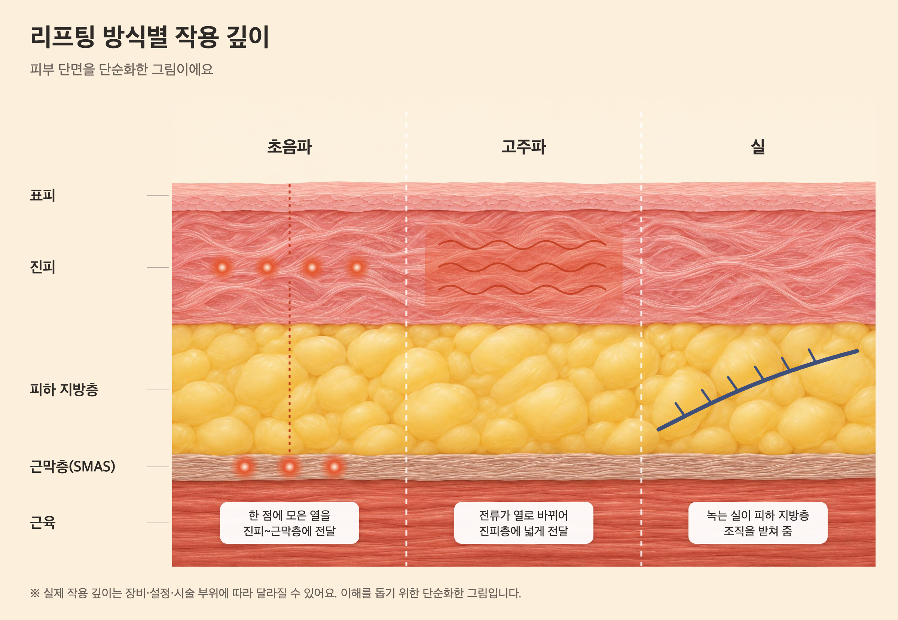

# 리프팅 시술, 처음이라면 꼭 알아야 할 8가지 질문

> **작성 정보**
> 작성: 블로그 편집팀 · 의학 감수: [원장님 확인: 감수 표기 방식]
> 작성일 2026-11-15 · 최종 검토일 2026-11-17 · 다음 검토 예정일 2027-11-17
> 일반 정보 제공 목적의 글이며, AI의 도움을 받아 초안을 작성하고 사람이 검토했어요.

비수술 리프팅은 피부 속에 열을 전달하거나 실을 넣어, 처진 피부의 탄력을 돕는 시술을 말해요[1][2][4]. 턱선이나 볼이 예전보다 내려온 것 같아 찾아보면 초음파·고주파·실 같은 말이 한꺼번에 나와 막막해지기 쉬워서, 첫 상담에서 자주 받는 질문 여덟 가지를 정리했어요. 부작용이 궁금하시다면 Q5부터 보셔도 괜찮아요.

> **핵심 정리**
> - 초음파·고주파 리프팅은 열로 콜라겐의 수축과 재생을 돕고, 실 리프팅은 주로 녹는 실로 조직을 받쳐 줘요.
> - 세 방법은 작용하는 깊이와 방식, 회복 과정이 서로 달라요.
> - 붓기·붉어짐 같은 일시적 반응이 흔하고, 드물게 화상이나 감염 같은 합병증도 보고되어 있어요.
> - 처짐이 심하면 비수술 리프팅이 도움이 되지 않을 수 있어, 진료로 피부 상태를 먼저 확인하는 게 좋아요.

## Q1. 리프팅은 어떤 원리로 작용하나요?

초음파·고주파 리프팅의 기본은 **열**이에요. 진피(피부 겉층 아래의 탄력층)나 그보다 깊은 근막층에 열이 전달되면 콜라겐 섬유가 먼저 수축하고, 이후 회복 과정에서 새 콜라겐이 만들어져요[1][2][3]. 그래서 시술 직후 느끼는 변화와, 몇 달에 걸쳐 나타나는 변화가 따로 있어요.

실 리프팅은 열 대신 실을 피부 아래에 넣어 처진 조직을 물리적으로 받쳐 주는 방식이에요. 주로 녹는 실을 쓰지만 녹지 않는 실도 있어요[4].

## Q2. 초음파·고주파·실 리프팅은 무엇이 다른가요?

가장 큰 차이는 **작용하는 깊이와 방식**이에요.

| 구분 | 초음파 | 고주파 | 실 |
|---|---|---|---|
| 방식 | 초음파를 한 점에 모아 열 전달 | 전류가 피부 속에서 열로 바뀜 | 실로 조직을 받침 |
| 주 작용 깊이 | 진피 ~ 근막층 | 진피층 | 피하 지방층 |
| 피부에 바늘 | 없음 | 없음 | 바늘로 실을 넣음 |

근막층(SMAS)은 피부와 지방층 아래에서 얼굴 조직을 받쳐 주는 얇은 막이에요. 초음파 리프팅 연구에서는 이 층 깊이에 열을 전달하는 방식이 쓰였어요[1]. 세 방법은 열이나 실이 닿는 층이 달라, 처짐이 생긴 깊이와 피부 두께, 지방량에 따라 고려 대상이 달라져요. 초음파와 고주파의 차이는 「초음파 리프팅과 고주파 리프팅, 무엇이 다른가요?」에 더 자세히 정리했어요.

## Q3. 어떤 분이 고려해볼 수 있나요?

연구는 주로 여성의 **가벼운~중간 정도의 처짐**을 대상으로 이루어졌고, 더 객관적인 측정과 남성 대상 연구가 필요하다고 정리되어 있어요[1]. 미국피부과학회는 처진 피부가 많으면 피부 탄력 시술이 도움이 되지 않을 수 있다고 안내해요[5]. 초음파 리프팅 연구를 정리한 분석에서도 처짐이 심한 경우에는 수술적 방법을 권했고[1], 고주파 리프팅도 수술만큼 처짐을 개선하지는 못한다고 정리되어 있어요[2]. 그래서 상담에서 기대치를 솔직하게 맞춰 보는 과정이 필요해요.

미국피부과학회는 임신 중이거나 피부 감염이 있거나 특정 약을 복용 중이면 피부 탄력 시술이 맞지 않다고 안내해요[5]. 고주파 리프팅은 자가면역 질환, 흡연, 심장 박동기 같은 체내 기기가 있을 때 주의 대상으로 꼽혀요[2]. [원장님 확인: 장비별 시술 제한 대상, 금속 보형물 해당 여부]

## Q4. 시술 과정과 통증은 어떤가요?

처음 오시는 분들은 보통 이런 순서로 진행돼요.

1. **상담과 진료**: 처진 부위와 피부 상태를 보고, 원하시는 변화와 일정을 함께 이야기해요.
2. **세안과 마취**: 필요한 경우 마취 크림을 바르고 기다려요.
3. **시술**: 방법과 부위에 따라 시간이 달라요.
4. **진정과 안내**: 시술 후 주의사항을 설명드려요.

초음파 리프팅은 연구에서 중간 정도의 통증이 보고됐어요. 마취 크림이나 진통제를 쓴 뒤에도 통증이 있었고, 눈가와 턱 아래 부위가 더 아프게 느껴지는 경향이 있었어요[1]. 느끼는 정도는 사람마다 달라서, 불편하시면 바로 말씀해 주셔도 괜찮아요. [원장님 확인: 통증 관리 방법]

## Q5. 시술 후 반응과 부작용은 무엇인가요?

**시술 효과와 부작용은 피부 상태와 시술 강도에 따라 사람마다 달라요.**

- **초음파 리프팅**: 일시적인 붉어짐과 붓기가 흔하고, 드물게 화상이나 줄무늬 자국도 보고됐어요[1]. 한 연구에서는 붉어짐이 1~2시간, 가벼운 붓기가 며칠, 멍이 1~2주 안에 가라앉았어요[1].
- **고주파 리프팅**: 일시적인 붉어짐과 붓기가 주로 보고되고, 드물게 얕은 딱지, 가벼운 윤곽 변화, 피부 아래 붉은 구진이 보고됐어요[2]. 전문가 합의에서는 부작용이 드물고 대개 가볍다고 정리했지만, 그 근거 일부가 제조사 자료라는 한계도 함께 봐야 해요[3].
- **실 리프팅**: 여러 연구를 모은 분석에서 붓기가 약 35%로 가장 많이 보고됐고, 피부 함몰(약 10%), 감각 이상(약 6%), 실이 비치거나 만져짐(약 4%), 감염·실 돌출(각 약 2%) 순이었어요[4]. 같은 분석에서 50세 이상은 피부 함몰과 감염 위험이 더 높았고, 녹는 실은 녹지 않는 실보다 감각 이상과 실 돌출이 적었어요[4].

대부분 시간이 지나며 가라앉지만, 통증이 점점 심해지거나 열이 나거나 얼굴 움직임이 어색하게 느껴지면 바로 병원에 연락해 주세요.

## Q6. 결과는 언제 보이고 얼마나 유지되나요?

콜라겐이 수축하는 변화는 시술 직후 느껴지기도 하지만, 새 콜라겐은 몇 달에 걸쳐 천천히 만들어져요[1][2]. 미국피부과학회도 비수술 탄력 시술의 변화는 서서히 나타난다고 안내해요[5].

유지 기간도 한 가지로 말씀드리기 어려워요. 나이, 피부 두께, 처짐 정도, 자외선 노출 같은 생활 습관에 따라 달라지기 때문이에요. 한 번으로 끝나는 변화라기보다, 피부 상태에 맞춰 관리 주기를 함께 정해 가는 과정으로 생각해 주시면 좋아요. [원장님 확인: 일반적인 시술 간격]

## Q7. 시술 전에 무엇을 준비하면 좋을까요?

복용 중인 약, 예전에 받은 시술, 피부 질환이나 켈로이드 체질이 있다면 진료 때 꼭 말씀해 주세요. 결혼식이나 발표처럼 중요한 일정이 있다면 붓기·멍이 가라앉는 기간을 고려해 시작 시점을 함께 정해요. [원장님 확인: 시술 전 중단해야 할 약]

## Q8. 첫 상담 때 무엇을 물어보면 좋을까요?

- 제 처짐은 어느 정도이고, 비수술 시술로 도움이 될 수 있는 범위인가요?
- 권하시는 방법과 그 이유는 무엇인가요?
- 시술 후 붓기·멍은 얼마나 가고, 다음 날 출근할 수 있나요?
- 제 나이와 피부에서 특히 주의할 부작용은 무엇인가요?
- 부작용이 생기면 어떻게 연락하고 관리받을 수 있나요?
- 비용과 횟수는 어떻게 되나요?

## 마무리하며

리프팅은 시술 이름보다 **내 피부의 지금 상태**를 먼저 아는 게 중요해요. 원리와 차이, 생길 수 있는 반응을 알고 상담에 오시면 훨씬 편하게 결정하실 수 있어요. 처음이라 망설여지신다면 진료로 피부 상태부터 확인해 보셔도 괜찮아요.

[추후 기입: 위치·진료 시간·예약 방법]

---

**참고 문헌**
1. [Contini M, Hollander MHJ, Vissink A, et al., A systematic review of the efficacy of microfocused ultrasound for facial skin tightening (Int J Environ Res Public Health, 2023;20(2):1522)](https://pubmed.ncbi.nlm.nih.gov/36674277/)
2. [Dayan E, Burns AJ, Rohrich RJ, Theodorou S, The use of radiofrequency in aesthetic surgery (Plast Reconstr Surg Glob Open, 2020;8(8):e2861)](https://pmc.ncbi.nlm.nih.gov/articles/PMC7489578)
3. [Chapas A, Biesman BS, Chan HHL, et al., Consensus recommendations for 4th generation non-microneedling monopolar radiofrequency for skin tightening: a Delphi consensus panel (J Drugs Dermatol, 2020;19(1):20–26)](https://jddonline.com/articles/consensus-recommendations-for-4th-generation-non-microneedling-monopolar-radiofrequency-for-skin-tig-S1545961620P0020X/?_page=5)
4. [Niu Z, Zhang K, Yao W, et al., A meta-analysis and systematic review of the incidences of complications following facial thread-lifting (Aesthetic Plast Surg, 2021;45(5):2148–2158)](https://pubmed.ncbi.nlm.nih.gov/33821308/)
5. [American Academy of Dermatology, Many ways to firm sagging skin (AAD, 열람 2026)](https://www.aad.org/public/cosmetic/younger-looking/firm-sagging-skin)

※ 이 글은 리프팅 시술에 대한 일반적인 정보이며, 진단이나 치료를 대신하지 않습니다. 시술 효과와 부작용은 개인에 따라 다를 수 있으므로 의료진과 충분히 상담한 뒤 결정하시기 바랍니다.
