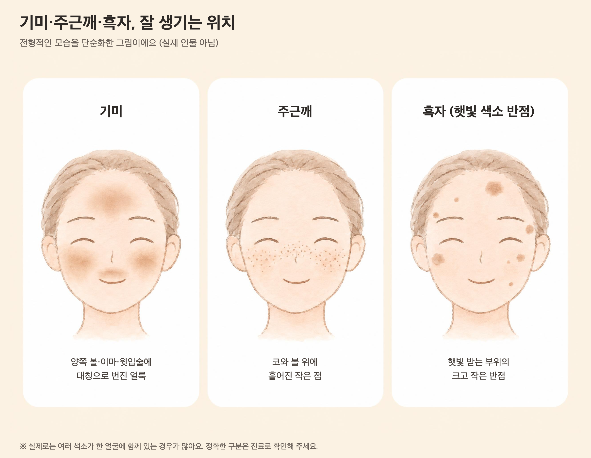

# 기미와 잡티, 어떻게 구분하나요? 처음 알아보는 분을 위한 6가지 질문

"이게 기미인가요, 잡티인가요?" 색소 고민으로 처음 오시는 분들께 저희 병원이 자주 받는 질문이에요. 둘은 비슷해 보여도 생기는 이유와 관리 방향이 달라요.

> **핵심 정리**
> - 기미는 양쪽 볼·이마에 대칭으로 번지는 갈색 얼룩이고, 자외선과 호르몬 변화가 영향을 줘요.
> - 흔히 '잡티'라고 부르는 것에는 주근깨와 흑자(햇빛 색소 반점)가 섞여 있어요.
> - 여러 색소가 한 얼굴에 함께 있는 경우가 많아 진료로 확인하는 게 정확해요.
> - 어떤 색소든 자외선 차단이 관리의 기본이에요.

## Q1. 기미와 잡티는 각각 무엇인가요?

**기미**는 이마·볼·코·윗입술 등에 생기는 갈색 얼룩으로, 얼굴 가운데 부위에 생기는 유형이 흔해요[1].

**잡티**는 의학 용어가 아니라 작은 갈색 반점을 통틀어 부르는 말로, 주로 두 가지가 섞여 있어요.
- **주근깨**: 어릴 때부터 생기는 작은 점 모양 색소로, 체질의 영향이 커요[2].
- **흑자(햇빛 색소 반점)**: 햇빛을 오래 받은 부위에 성인이 된 뒤 생기는 반점이에요[2].

## Q2. 생김새로 어떻게 다른가요?

| 구분 | 기미 | 주근깨 | 흑자 |
|---|---|---|---|
| 모양 | 넓게 번진 얼룩 | 작은 점 여러 개 | 크고 작은 반점 |
| 분포 | 양쪽 대칭인 경우가 많음 | 흩어져 있음 | 햇빛 받는 부위 |
| 생기는 시기 | 주로 성인 이후 | 어린 시절부터 | 나이 들며 늘어남 |

전형적인 모습일 뿐, 실제로는 여러 색소가 겹쳐 있는 경우가 많아요[2].

## Q3. 왜 생기나요?

- **기미**: 자외선이 시작과 악화에 모두 관여하고[1], 임신·경구 피임약·호르몬 치료 같은 호르몬 변화도 영향을 줘요[1]. 체질적 요인도 있어요.
- **주근깨**: 타고난 체질에 햇빛 노출이 더해져 나타나요[2].
- **흑자**: 오랜 기간 쌓인 자외선 노출이 주된 원인이에요[2].

## Q4. 스스로 구분할 수 있나요?

대략 짐작은 되지만 정확히 구분하기는 어려워요. 기미와 비슷해 보이는 다른 색소 질환도 있어서[1], 진료에서는 우드등이나 피부 확대경으로 색소가 어느 층에 있는지 함께 확인해요[1]. **모양·크기·색이 변하는 점**이 있다면 따로 바로 진료를 받아 보세요.

## Q5. 치료 방향은 어떻게 다른가요?

**기미**는 자외선 차단과 자극 줄이기가 기본이고, 필요에 따라 바르는 약·먹는 약·레이저를 함께 고려해요[1]. 레이저는 기미를 없애는 치료가 아니며, 다시 짙어지거나 반동 색소침착이 생길 수 있다고 보고되어 있어요[3]. 저출력 레이저 토닝에서도 드물게 색소가 얼룩덜룩하게 빠지거나 짙어지는 부작용이 보고되었어요[4]. 그래서 피부 반응을 보며 조절하는 게 중요해요.

**잡티(주근깨·흑자)**는 색소 레이저가 주된 선택지예요. 시술 후 딱지, 붉어짐, 일시적 색소침착이 생길 수 있어요.

색소가 어떻게 섞여 있는지에 따라 순서와 방법이 달라지니, 진료로 먼저 구분하는 걸 권해 드려요.

## Q6. 일상에서 할 수 있는 관리는?

- **자외선 차단제**: SPF 30 이상을 매일 바르고, 외출이 길면 덧발라 주세요[1].
- **마찰 줄이기**: 세게 문지르는 세안이나 잦은 각질 제거는 피해 주세요.
- **호르몬 관련 약**: 복용 중에 기미가 생겼다면 진료 때 알려 주세요. 임의로 끊지 말고 처방한 의사와 상의하세요.

## 마무리하며

기미와 잡티는 이름보다 **내 얼굴에 어떤 색소가 섞여 있는지** 아는 게 먼저예요. 헷갈리신다면 진료로 색소 상태부터 확인해 보셔도 괜찮아요. 저희 병원에서 차근차근 설명드릴게요.

[추후 기입: 위치(서면)·진료 시간·예약 방법]

---

**참고 문헌**
1. [Ogbechie-Godec & Elbuluk, Melasma: an Up-to-Date Comprehensive Review (Dermatology and Therapy, 2017)](https://link.springer.com/article/10.1007%2Fs13555-017-0194-1)
2. [Plensdorf et al., Pigmentation Disorders: Diagnosis and Management (American Family Physician, 2017)](https://www.aafp.org/pubs/afp/issues/2017/1215/p797.html)
3. [Laser and light therapies for melasma (International Journal of Women's Dermatology, 2017)](https://pmc.ncbi.nlm.nih.gov/articles/PMC5418955)
4. [Low-fluence Q-switched Nd:YAG laser for melasma: a systematic review (Medicina, 2022)](https://mdpi.com/1648-9144/58/7/936)

※ 이 글은 색소 질환에 대한 일반적인 정보이며, 진단이나 치료를 대신하지 않습니다. 치료 효과와 부작용은 개인에 따라 다를 수 있으므로 의료진과 충분히 상담한 뒤 결정하시기 바랍니다.
