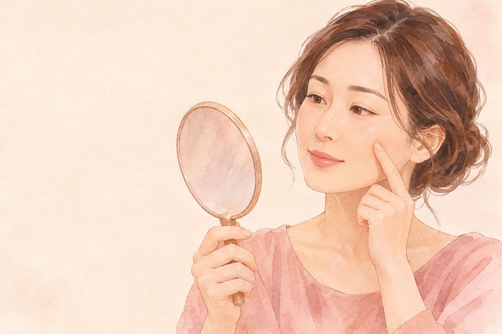

# 기미와 잡티, 어떻게 구분하나요? 처음 알아보는 분을 위한 8가지 질문

> **작성 정보**
> 작성: 블로그 편집팀 · 의학 감수: [원장님 확인: 감수 표기 방식]
> 작성일 2026-11-16 · 최종 검토일 2026-11-17 · 다음 검토 예정일 2027-11-17
> 일반 정보 제공 목적의 글이며, AI의 도움을 받아 초안을 작성하고 사람이 검토했어요.

기미는 이마·볼·코·윗입술 등에 생기는 갈색 얼룩으로, 자외선과 호르몬 변화가 영향을 주는 색소 질환이에요[1]. "이게 기미인가요, 잡티인가요?"는 색소 고민으로 처음 오시는 분들께 저희 병원이 자주 받는 질문인데, 둘은 비슷해 보여도 생기는 이유와 관리 방향이 달라요.

*AI로 만든 일러스트이며 실제 환자가 아닙니다.*

> **핵심 정리**
> - 기미는 양쪽 볼·이마에 대칭으로 번지는 갈색 얼룩이고, 자외선과 호르몬 변화가 영향을 줘요.
> - 흔히 '잡티'라고 부르는 것에는 주근깨와 흑자(햇빛 색소 반점)가 섞여 있어요.
> - 주근깨는 꼭 치료해야 하는 것은 아니고, 기미는 레이저 후 다시 짙어질 수 있어 접근이 달라요.
> - 어떤 색소든 자외선 차단이 관리의 기본이에요.

## Q1. 기미와 잡티는 각각 무엇인가요?

**기미**는 이마·볼·코·윗입술 등에 생기는 갈색 얼룩으로, 얼굴 가운데 부위에 생기는 유형이 흔해요[1].

**잡티**는 의학 용어가 아니라 작은 갈색 반점을 통틀어 부르는 말로, 주로 두 가지가 섞여 있어요.
- **주근깨**: 타고난 체질에 햇빛 노출이 더해져 어릴 때부터 생기는 1~2mm 정도의 작은 점이에요. 겨울에 옅어지기도 해서 꼭 치료해야 하는 것은 아니에요[2].
- **흑자(햇빛 색소 반점)**: 햇빛을 받은 부위에 성인이 된 뒤 생기는 반점으로, 주근깨보다 크고 경계가 뚜렷해요[2].

## Q2. 생김새로 어떻게 다른가요?

| 구분 | 기미 | 주근깨 | 흑자 |
|---|---|---|---|
| 모양 | 넓게 번진 얼룩 | 1~2mm 작은 점 여러 개 | 주근깨보다 큰 반점 |
| 분포 | 양쪽 대칭인 경우가 많음 | 흩어져 있음 | 햇빛 받는 부위 |
| 생기는 시기 | 주로 성인 이후 | 어린 시절부터 | 성인 이후 |

표는 전형적인 모습이에요[1][2]. 기미가 있는 사람은 흑자나 점도 더 많다는 보고가 있어서[1], 한 얼굴에 여러 색소가 함께 보이기도 해요. 피부 톤에 따라 흔한 색소도 달라, 기미는 피부 톤이 어두운 편에서 더 흔하고, 흑자는 백인과 아시아인에게 가장 흔하다고 정리되어 있어요[2].

## Q3. 왜 생기나요?

- **기미**: 자외선이 시작과 악화에 모두 관여하고, 임신·경구 피임약·호르몬 치료 같은 호르몬 변화도 영향을 줘요[1].
- **주근깨**: 밝은 피부의 타고난 체질에 어릴 때의 햇빛 노출이 더해져 나타나요[2].
- **흑자**: 짧고 강하게 또는 오랜 기간 받은 자외선이 원인이에요[2].

임신 중에 생긴 기미는 출산 뒤 저절로 옅어지는 경우가 있어, 치료를 미루고 지켜보기를 권하기도 해요[2]. 다만 몇 년 이상 이어지는 경우도 있어요[7]. [원장님 확인: 수유 중 치료 범위]

## Q4. 스스로 구분할 수 있나요?

대략 짐작은 되지만 정확히 구분하기는 어려워요. 기미와 비슷해 보이는 다른 피부 질환도 있기 때문이에요[1]. 기미는 대개 눈으로 보고 진단하지만, 다른 질환과 비슷해 보이면 조직검사를 하기도 해요[7]. 우드등(특정 파장의 빛을 비추는 검사)이나 피부 확대경으로 색소의 깊이를 가늠하지만, 우드등만으로 겉층과 깊은 층의 색소를 완전히 나누지는 못해요[3].

**모양·크기·색이 변하는 점**이 있다면 흑색종 같은 질환이 아닌지 확인하려고 조직검사를 하기도 하니, 따로 바로 진료를 받아 보세요[2].

여드름이 지나간 자리에 남은 **갈색 자국(염증 후 색소침착)**도 잡티와 헷갈리기 쉬워요. 이 자국에 대한 레이저 효과는 근거가 아직 부족하다고 정리되어 있어요[5].

## Q5. 치료 방향은 어떻게 다른가요?

- **기미**: 자외선 차단과 바르는 약이 기본이고, 필요에 따라 먹는 약이나 시술을 더하는 식으로 단계적으로 계획해요[1][3]. 먹는 약은 아직 연구가 이어지고 있어 사람마다 맞는지 진료로 판단해야 해요[1]. 레이저는 기미를 없애는 치료가 아니라 색소를 옅게 하는 데 도움을 주는 방법으로 정리되어 있어요[3].
- **주근깨**: 꼭 치료할 필요는 없고, 원하면 바르는 약, 냉동치료, 화학 박피, 레이저·빛 치료를 고려해요[2].
- **흑자**: 색소 레이저 등 시술이 선택지가 돼요. [원장님 확인: 흑자에 시행하는 방법]

색소가 어떻게 섞여 있는지에 따라 순서와 방법이 달라지니, 진료로 먼저 구분하는 걸 권해 드려요.

## Q6. 치료 후 생길 수 있는 반응과 부작용은?

**치료 효과와 부작용은 피부 상태와 시술 강도에 따라 사람마다 달라요.**

- **염증 후 색소침착**: 레이저·빛 치료나 냉동치료 뒤 시술 부위가 짙어질 수 있고, 몇 달 이상 이어지기도 해요[2].
- **기미의 반동 색소침착·재발**: 레이저 후 다시 짙어지거나, 시술 전보다 오히려 짙어지는 경우가 보고되어 있어요[3].
- **저출력 레이저 토닝**: 드물게 색소가 얼룩덜룩하게 빠질 수 있고, 강하게 시술하면 특히 피부 톤이 어두운 경우 오히려 짙어질 수 있어요[4].

호르몬 약을 먹다가 기미가 생겼다면 약을 끊으면 옅어질 수 있지만, 수년 동안 이어지기도 해요[7]. 임의로 끊지 말고 처방한 의사와 먼저 상의해 주세요.

## Q7. 일상에서 할 수 있는 관리는?

- **자외선 차단제**: 자외선 A·B를 모두 막는 SPF 30 이상 제품을 매일 바르고, 밖에 있을 때는 2시간마다, 땀을 흘린 뒤에는 바로 덧발라 주세요[6][8].
- **겨울·흐린 날에도**: 자외선은 구름을 통과하고, 쌓인 눈은 자외선을 반사해요[6].
- **가시광선까지**: 기미는 가시광선에도 짙어질 수 있어, 산화철이 들어간 색조 자외선 차단제를 권하기도 해요[8].
- **순한 제품**: 바를 때 따갑거나 화끈거리는 제품은 피부를 자극해 색소를 짙게 할 수 있으니, 향이 없는 순한 제품을 골라 주세요[8].
- **화장 순서**: 치료 중에 화장으로 가리고 싶다면 바르는 약, 자외선 차단제, 가리는 화장 순서로 발라요[7].

## Q8. 상담 때 무엇을 물어보면 좋을까요?

- 제 얼굴에는 어떤 색소가 섞여 있나요?
- 기미라면 레이저 말고 먼저 해 볼 방법은 무엇인가요?
- 주근깨는 꼭 치료해야 하나요?
- 시술 후 색소가 짙어지거나 하얘질 위험은 어느 정도인가요?
- 관리를 멈추면 다시 짙어질 수 있나요?

## 마무리하며

기미와 잡티는 이름보다 **내 얼굴에 어떤 색소가 섞여 있는지** 아는 게 먼저예요. 헷갈리신다면 진료로 색소 상태부터 확인해 보셔도 괜찮아요. 저희 병원에서 차근차근 설명드릴게요.

[추후 기입: 위치·진료 시간·예약 방법]

---

**참고 문헌**
1. [Ogbechie-Godec OA, Elbuluk N, Melasma: an up-to-date comprehensive review (Dermatol Ther (Heidelb), 2017;7(3):305–318)](https://link.springer.com/article/10.1007/s13555-017-0194-1)
2. [Plensdorf S, Livieratos M, Dada N, Pigmentation disorders: diagnosis and management (Am Fam Physician, 2017;96(12):797–804)](https://www.aafp.org/pubs/afp/issues/2017/1215/p797.html)
3. [Trivedi MK, Yang FC, Cho BK, A review of laser and light therapy in melasma (Int J Womens Dermatol, 2017;3(1):11–20)](https://pmc.ncbi.nlm.nih.gov/articles/PMC5418955)
4. [Lee YS, Lee YJ, Lee JM, et al., The low-fluence Q-switched Nd:YAG laser treatment for melasma: a systematic review (Medicina (Kaunas), 2022;58(7):936)](https://www.mdpi.com/1648-9144/58/7/936)
5. [Agbai O, Hamzavi I, Jagdeo J, Laser treatments for postinflammatory hyperpigmentation: a systematic review (JAMA Dermatol, 2017;153(2):199–206)](https://pubmed.ncbi.nlm.nih.gov/27973642/)
6. [American Academy of Dermatology, American Academy of Dermatology survey shows sun protection lacking in winter (AAD, 2024)](https://www.aad.org/news/survey-shows-sun-protection-lacking-in-winter)
7. [American Academy of Dermatology, Melasma: diagnosis and treatment (AAD, 2022)](https://www.aad.org/public/diseases/a-z/melasma-treatment)
8. [American Academy of Dermatology, Melasma: self-care (AAD, 2023)](https://www.aad.org/public/diseases/a-z/melasma-self-care)

※ 이 글은 색소 질환에 대한 일반적인 정보이며, 진단이나 치료를 대신하지 않습니다. 치료 효과와 부작용은 개인에 따라 다를 수 있으므로 의료진과 충분히 상담한 뒤 결정하시기 바랍니다.
