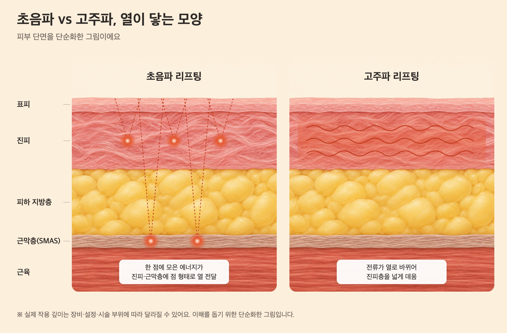

# 초음파 리프팅과 고주파 리프팅, 무엇이 다른가요?

> **작성 정보**
> 작성: 블로그 편집팀 · 의학 감수: [원장님 확인: 감수 표기 방식]
> 작성일 2026-11-19 · 최종 검토일 2026-11-19 · 다음 검토 예정일 2027-11-19
> 일반 정보 제공 목적의 글이며, AI의 도움을 받아 초안을 작성하고 사람이 검토했어요.

초음파 리프팅과 고주파 리프팅은 피부 속에 열을 전달해 콜라겐의 수축과 재생을 돕는 비수술 리프팅이에요[3][4][6]. 둘 다 열을 쓰지만 열을 만드는 방식과 닿는 깊이가 달라요. 어느 쪽이 더 좋다기보다, 차이를 알아야 내 피부에 맞는 쪽을 고를 수 있어요.

> **핵심 정리**
> - 초음파는 에너지를 한 점에 모아 깊은 층까지 점 형태로 열을 전달해요.
> - 고주파는 피부 속 전류가 열로 바뀌어 진피층을 넓게 데워요.
> - 두 방식 모두 통증·열감이 있고, 시술 후 붉어짐과 붓기가 흔해요.
> - 처짐의 위치와 깊이, 피부 두께, 회복 일정에 따라 고려 대상이 달라져요.

## Q1. 열을 만드는 방식이 어떻게 다른가요?

**초음파 리프팅**은 돋보기로 햇빛을 한 점에 모으듯, 초음파 에너지를 피부 속 특정 깊이에 모아요. 모인 지점에만 작은 열 응고점이 생기고 그 위아래 조직은 상대적으로 덜 영향을 받아요[3].

**고주파 리프팅**은 피부에 흐르는 전류가 열로 바뀌는 원리예요. 빠르게 방향이 바뀌는 전류 때문에 피부 속 분자들이 움직이며 부딪히고, 그때 생긴 열이 진피를 넓게 고르게 데워요[4][6]. 열을 받은 콜라겐이 수축한 뒤 회복 과정에서 새 콜라겐이 만들어져요[4][6].

## Q2. 작용하는 깊이는 어떻게 다른가요?

| 구분 | 초음파 리프팅 | 고주파 리프팅 |
|---|---|---|
| 열의 모양 | 점 형태로 모인 열 | 넓게 퍼진 열 |
| 주로 닿는 깊이 | 진피부터 근막층(SMAS)까지 | 진피층 중심 |
| 깊이 조절 | 정해진 깊이를 골라 겨냥 | 주파수·팁에 따라 달라짐 |

근막층(SMAS)은 피부와 지방층 아래에서 얼굴 조직을 받쳐 주는 얇은 막으로, 얼굴 처짐과 관련된 깊은 지지층이에요[2][3]. 두 방식은 열이 닿는 층이 달라서, 처짐이 생긴 깊이에 따라 고려 대상이 달라져요. 실제 깊이는 장비와 설정에 따라 달라요[4].

## Q3. 결과는 어떻게, 언제 나타나나요?

두 방법 모두 열 자극 뒤 새 콜라겐이 만들어지는 과정을 거치기 때문에, 변화는 시술 직후보다 몇 달에 걸쳐 서서히 나타난다고 안내돼요[5][6]. 고주파 리프팅의 결과는 늘 예측할 수 있지는 않고 대체로 완만하며, 수술만큼 처짐을 바꾸지는 않는다는 정리도 있어요[6].

초음파 리프팅은 하안면, 목, 눈가 부위 연구가 많고[1], 주로 가볍거나 중간 정도의 처짐을 대상으로 했어요[2]. 연구 대상이 모두 여성이었고 개선 정도를 주로 사람이 눈으로 보고 매기는 척도로 평가해서, 남성 대상 연구와 더 객관적인 측정이 필요하다는 한계도 함께 정리되어 있어요[2].

## Q4. 시술 중 통증은 어떤가요?

초음파 리프팅은 체계적 문헌고찰에서 중간 정도의 통증이 있는 시술로 정리됐어요[2]. 고주파 리프팅은 전문가 합의에서 "뜨겁지만 견딜 만한" 정도를 목표로, 환자가 느끼는 열감을 들으며 에너지를 조절하도록 권했어요[4]. 통증에 예민하시다면 시술 전에 통증을 줄이는 방법을 의료진과 미리 상의해 주세요. [원장님 확인: 통증 관리 방법]

## Q5. 시술 후 반응과 부작용은 어떻게 다른가요?

**시술 효과와 부작용은 피부 상태와 시술 강도에 따라 사람마다 달라요.**

미국피부과학회는 초음파·고주파 같은 비침습 리프팅 뒤에는 보통 붉어짐과 붓기가 있고, 회복 기간은 거의 없거나 짧은 편이라고 안내해요[5]. 다만 반응의 정도는 사람마다 달라서, 중요한 일정이 있다면 여유를 두고 날짜를 정해 주세요.

| 구분 | 초음파 리프팅 | 고주파 리프팅 |
|---|---|---|
| 흔한 반응 | 일시적인 붉어짐, 붓기[2] | 일시적인 붉어짐, 붓기[6] |
| 드물게 보고된 반응 | 저린 느낌, 멍, 따끔거림, 턱 부위 화상, 줄 모양 자국, 접촉 피부염 (약 2%)[2] | 표면 딱지, 피부 아래 작은 붉은 돌기, 얼굴 윤곽이 살짝 꺼지는 변화[6] |

고주파 리프팅에 대한 전문가 합의에서는 부작용이 드물고 대개 가볍다고 정리했지만, 그 근거 일부가 제조사 자료라는 한계가 있어요[4]. 대부분 시간이 지나며 가라앉지만, 통증이 점점 심해지거나 물집이 생기거나 얼굴 움직임이 어색하게 느껴지면 바로 병원에 연락해 주세요.

## Q6. 어떤 기준으로 고르면 될까요?

- **처짐의 깊이**: 피부 표면의 탄력 저하인지, 더 깊은 지지층의 처짐인지
- **처진 위치**: 턱선, 볼, 눈가 등 신경 쓰이는 부위
- **피부 두께와 지방량**: 같은 처짐이라도 고려 대상이 달라져요
- **회복 일정과 통증 민감도**: 중요한 일정이 가까운지, 통증에 예민한 편인지

처짐이 심하면 비수술 리프팅이 도움이 되지 않을 수 있고, 임신 중이거나 피부 감염이 있거나 특정 약을 복용 중이라면 맞지 않을 수 있어요[5]. 초음파 리프팅도 처짐이 심하거나 체질량지수가 높을수록 결과가 떨어져, 상대적 금기로 제시됐어요[2]. 이 기준은 스스로 판단하기보다 진료에서 피부를 직접 보고 함께 정하는 게 정확해요.

## Q7. 생활 관리와 상담 때 물어볼 질문은?

미국피부과학회는 좋은 결과를 위한 생활 습관으로 건강한 체중 유지, 금연, 절주, 자외선 차단과 실내 태닝 피하기를 꼽아요[5]. 시술 부위에 염증·상처가 있거나 심장 박동기 같은 체내 기기가 있다면 진료 전에 꼭 알려 주세요. [원장님 확인: 장비별 시술 제한 대상]

- 제 처짐은 어느 깊이에서 생긴 건가요?
- 초음파와 고주파 중 권하시는 방법과 그 이유는 무엇인가요?
- 시술 후 붓기는 얼마나 가고, 화장과 출근은 언제부터 가능한가요?
- 일반적인 시술 간격과 비용은 어떻게 되나요?

## 마무리하며

초음파와 고주파는 같은 목적을 다른 방식으로 접근하는 시술이에요. 이름보다 **내 처짐이 어느 깊이에서 생겼는지**를 먼저 알면 선택이 쉬워져요. 리프팅 기본 원리와 실 리프팅은 이전 글 「리프팅 시술, 처음이라면 꼭 알아야 할 8가지 질문」에 정리해 두었어요.

[추후 기입: 위치·진료 시간·예약 방법]

---

**참고 문헌**
1. [Haykal D, Sattler S, Verner I, et al., A systematic review of high-intensity focused ultrasound in skin tightening and body contouring (Aesthet Surg J, 2025;45(7):690–698)](https://pubmed.ncbi.nlm.nih.gov/40184185/)
2. [Contini M, Hollander MHJ, Vissink A, et al., A systematic review of the efficacy of microfocused ultrasound for facial skin tightening (Int J Environ Res Public Health, 2023;20(2):1522)](https://pubmed.ncbi.nlm.nih.gov/36674277/)
3. [Pavicic T, Ballard JR, Bykovskaya T, et al., Microfocused ultrasound with visualization: consensus on safety and review of energy-based devices (J Cosmet Dermatol, 2022;21(2):636–647)](https://pmc.ncbi.nlm.nih.gov/articles/PMC9305832)
4. [Chapas A, Biesman BS, Chan HHL, et al., Consensus recommendations for 4th generation non-microneedling monopolar radiofrequency for skin tightening: a Delphi consensus panel (J Drugs Dermatol, 2020;19(1):20–26)](https://jddonline.com/articles/consensus-recommendations-for-4th-generation-non-microneedling-monopolar-radiofrequency-for-skin-tig-S1545961620P0020X/?_page=5)
5. [American Academy of Dermatology, Many ways to firm sagging skin (AAD, 열람 2026)](https://www.aad.org/public/cosmetic/younger-looking/firm-sagging-skin)
6. [Dayan E, Burns AJ, Rohrich RJ, Theodorou S, The use of radiofrequency in aesthetic surgery (Plast Reconstr Surg Glob Open, 2020;8(8):e2861)](https://pmc.ncbi.nlm.nih.gov/articles/PMC7489578)

※ 이 글은 리프팅 시술에 대한 일반적인 정보이며, 진단이나 치료를 대신하지 않습니다. 시술 효과와 부작용은 개인에 따라 다를 수 있으므로 의료진과 충분히 상담한 뒤 결정하시기 바랍니다.
