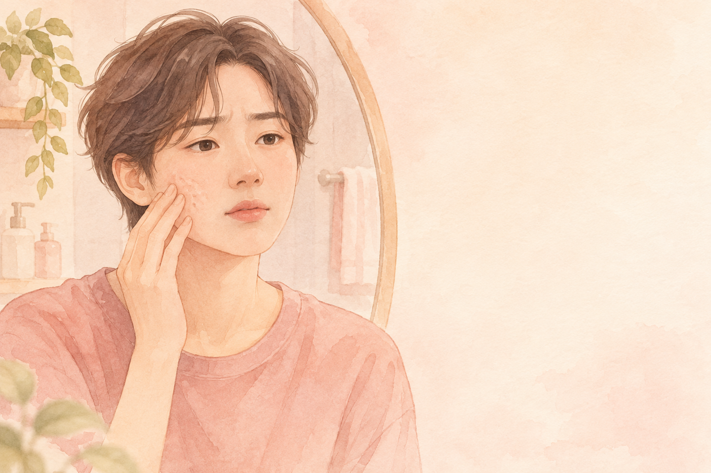

# 여드름 흉터, 종류별 원인과 치료 선택지

> **작성 정보**
> 작성: 블로그 편집팀 · 의학 감수: [원장님 확인: 감수 표기 방식]
> 작성일 2026-11-23 · 최종 검토일 2026-11-23 · 다음 검토 예정일 2027-11-23
> 일반 정보 제공 목적의 글이며, AI의 도움을 받아 초안을 작성하고 사람이 검토했어요.

여드름 흉터는 여드름 염증이 회복되는 과정에서 조직이 부족하거나 지나치게 만들어져, 피부가 패이거나 솟은 상태예요[1]. 여드름은 가라앉았는데 패인 자리가 남아 고민이신가요? 흉터는 생김새에 따라 종류가 나뉘고 종류마다 접근 방법이 달라서, 내 흉터가 어떤 종류인지부터 알아두면 상담이 수월해져요.

*AI로 만든 일러스트이며 실제 환자가 아닙니다.*

> **핵심 정리**
> - 붉거나 갈색인 평평한 자국과, 피부가 패이거나 솟은 흉터는 서로 달라요.
> - 패인 흉터는 모양에 따라 아이스픽·박스카·롤링으로 나뉘어요.
> - 여드름이 아직 있다면 짜지 않고 염증을 빨리 가라앉히는 게 흉터를 줄이는 첫걸음이에요.
> - 레이저·필링 후에는 붉어짐, 붓기, 색소침착이 생길 수 있어요.

## Q1. 여드름 자국과 흉터는 같은 건가요?

비슷해 보여도 달라요. **붉거나 갈색으로 남은 평평한 자국**은 흉터 분류에서 가장 가벼운 단계로 묶기도 하지만, 굴곡이 아니라 색의 문제예요[1]. 반면 **흉터**는 피부가 패이거나 솟아 굴곡이 생긴 상태예요[1]. 손으로 쓸었을 때 높낮이가 느껴지는지가 첫 구분점이에요.

피부 톤이 밝은 편이면 붉은 자국이, 중간~어두운 편이면 갈색 자국(염증 후 색소침착)이 남기 쉽고, 몇 달 동안 이어질 수 있어요[4]. 갈색 자국은 원인이 된 여드름이 가라앉으면 대부분 시간이 지나며 옅어지지만, 오래 걸릴 수 있어요[5].

## Q2. 패인 흉터는 어떤 종류가 있나요?

여드름 흉터의 80~90%는 패인 흉터(피부가 꺼져 들어간 흉터, 위축성 흉터)이고, 모양에 따라 세 가지로 나눠요[1]. 패인 흉터 가운데 아이스픽이 약 60~70%, 박스카가 약 20~30%, 롤링이 약 15~25%를 차지한다고 보고되어 있어요[1]. 한 사람에게 세 가지가 함께 보이기도 하고, 서로 구분하기 어려울 때도 있어요[1].

| 구분 | 아이스픽 | 박스카 | 롤링 |
|---|---|---|---|
| 모양 | 좁고 깊은 V자 구멍 | 테두리가 각진 U자 | 완만한 물결 모양 |
| 폭 | 약 2mm 미만 | 약 1.5~4mm | 보통 4~5mm보다 넓음 |
| 특징 | 피부 겉층 아래 진피까지 깊게 패임 | 얕은 것과 깊은 것이 있음 | 피부 아래 섬유띠가 당겨서 생김 |

표의 수치와 특징은 문헌 [1]을 따랐어요.

## Q3. 솟은 흉터도 있나요?

있어요. 흉터 조직이 지나치게 만들어지면 피부가 도톰하게 솟는 **비후성 흉터**나, 원래 상처 범위를 넘어 커지는 **켈로이드**가 생길 수 있어요[1]. 내 흉터가 어느 쪽인지는 진료에서 확인해요.

## Q4. 여드름이 아직 있을 때 흉터를 줄이려면?

흉터는 깊고 아픈 여드름처럼 염증이 깊을수록 생기기 쉽고, 짜거나 뜯으면 염증이 커져 위험이 높아져요[6]. 가족 중 흉터가 잘 생기는 사람이 있으면 위험이 높아질 수 있지만, 누구에게 흉터가 생길지 미리 알 수는 없어요[6]. 그래서 짜기보다 진료를 받아 염증을 오래 끌지 않는 것이 중요해요[6]. 흉터는 옅어질 수 있지만 완전히 사라지는 경우는 드물어요[6].

흉터 치료는 보통 여드름이 조절된 뒤 시작해요. 최근 2년 안에 쓴 여드름 약이 있다면 미리 알려 주세요. 일부 약과 함께 하면 원치 않는 부작용이 생길 수 있어요[7].

## Q5. 아이스픽·박스카·롤링 흉터, 치료 방향은 어떻게 다른가요?

- **박스카·롤링**: 얕든 깊든 레이저 치료 대상이 될 수 있어요[1].
- **아이스픽·깊은 흉터**: 진피까지 깊게 패여 있어 겉을 재생시키는 방법만으로는 한계가 있어요. 그래서 흉터 하나하나를 따로 다루는 시술을 함께 고려해요[1]. [원장님 확인: 실제로 시행하는 시술명]
- **롤링**: 피부 아래 섬유띠가 당기는 구조라, 흉터를 아래 조직에서 떼어 내는 방법(서브시전)이 함께 거론돼요[1].
- **솟은 흉터(비후성·켈로이드)**: 패인 흉터와 접근이 달라 진료에서 따로 계획해요.

문헌에서는 화학 필링, 미세침 시술, 서브시전, 펀치 기법, 필러 등 여러 비에너지 방법도 다루고 있어요[2]. [원장님 확인: 이 가운데 시행하는 방법] 모든 흉터에 맞는 한 가지 방법은 없다고 정리되어, 흉터 구성에 맞춰 여러 방법을 조합하는 추세예요[2].

## Q6. 시술 후에는 어떤 반응과 부작용이 생길 수 있나요?

**치료 효과와 부작용은 피부 상태와 시술 강도에 따라 사람마다 달라요.**

- **프랙셔널 CO₂ 레이저**: 연구를 모은 리뷰에서 일시적인 붉어짐, 붓기, 색소침착이 흔했고 대부분 몇 주 안에 가라앉았어요. 드물게 색소침착이 한 달 넘게 이어지거나 여드름이 다시 올라와 추가 치료가 필요했던 사례도 있었어요. 시술 중 가벼운 통증·화끈거림이 몇 시간 이어질 수 있고, 점 모양 출혈이나 딱지가 생길 수 있어요[3].
- **화학 필링**: 깊게 작용하는 필링은 피부 톤이 어둡거나, 농도가 높거나, 시술 후 자외선 차단 같은 관리를 지키지 않으면 색소침착 위험이 커져요[2].
- **흉터 부위에 따로 하는 시술**: [원장님 확인: 시술별 흔한 부작용·회복 기간]
- **공통**: 회복하는 동안 자외선 차단과 자극 줄이기가 중요해요[2].

통증이 심해지거나, 진물·고름이 생기거나, 색소침착이 오래 이어지면 바로 병원에 알려 주세요. 켈로이드 체질이라면 시술 전에 꼭 말씀해 주세요. [원장님 확인: 시술 주의 대상]

## Q7. 첫 상담 때 무엇을 물어보면 좋을까요?

- 제 흉터는 어떤 종류가 섞여 있나요?
- 여드름이 아직 있는데 지금 흉터 치료를 시작해도 되나요?
- 권하시는 방법과 순서, 그 이유는 무엇인가요?
- 시술 중 통증은 어느 정도이고, 통증 관리는 어떻게 하나요?
- 예전에 시술 후 색소침착이 있었는데, 방법이나 관리가 달라지나요?
- 전체 비용과 횟수·간격은 어떻게 되나요?

## 마무리하며

여드름 흉터는 이름이 아니라 **모양과 깊이**에 따라 접근이 달라져요. 내 흉터가 어떤 종류인지 아는 것에서부터 시작해 보세요. 헷갈리신다면 진료로 흉터 상태부터 확인해 보셔도 괜찮아요.

[추후 기입: 위치·진료 시간·예약 방법]

---

**참고 문헌**
1. [Fabbrocini G, Annunziata MC, D'Arco V, et al., Acne scars: pathogenesis, classification and treatment (Dermatol Res Pract, 2010;2010:893080)](https://pmc.ncbi.nlm.nih.gov/articles/PMC2958495)
2. [Tam C, Khong J, Tam K, et al., A comprehensive review of non-energy-based treatments for atrophic acne scarring (Clin Cosmet Investig Dermatol, 2022;15:455–469)](https://www.dovepress.com/a-comprehensive-review-of-non-energy-based-treatments-for-atrophic-acn-peer-reviewed-fulltext-article-CCID)
3. [Ptaszek B, Czernecka M, Podsiadło S, The use of a fractional laser in acne scar treatment — a systematic review (Life (Basel), 2025;15(6):915)](https://www.ncbi.nlm.nih.gov/pmc/articles/PMC12194615/)
4. [American Academy of Dermatology, 7 reasons to treat acne early (AAD, 열람 2026)](https://www.aad.org/public/diseases/acne/diy/treat-early)
5. [American Academy of Dermatology, How to fade dark spots in darker skin tones (AAD, 2025)](https://www.aad.org/public/everyday-care/skin-care-secrets/routine/fade-dark-spots)
6. [American Academy of Dermatology, Acne scars: causes (AAD, 2023)](https://www.aad.org/public/diseases/acne/derm-treat/scars/causes)
7. [American Academy of Dermatology, Acne scars: consultation and treatment (AAD, 2023)](https://www.aad.org/public/diseases/acne/derm-treat/scars/treatment)

※ 이 글은 여드름 흉터에 대한 일반적인 정보이며, 진단이나 치료를 대신하지 않습니다. 치료 효과와 부작용은 개인에 따라 다를 수 있으므로 의료진과 충분히 상담한 뒤 결정하시기 바랍니다.
