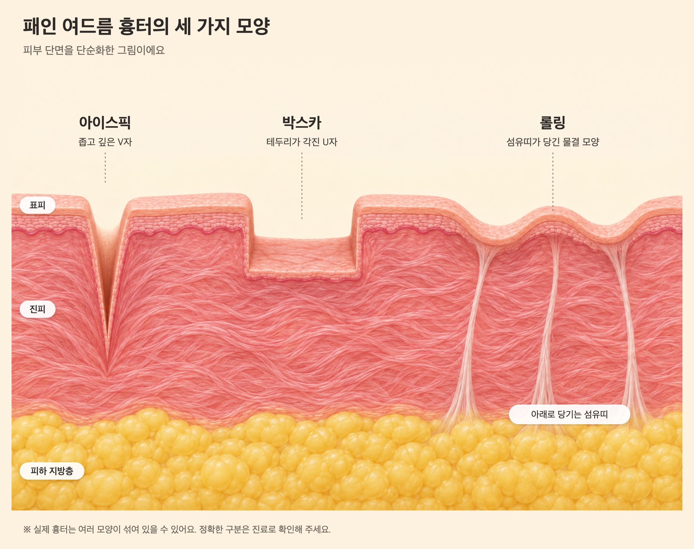

# 여드름 흉터, 종류별 원인과 치료 선택지

여드름은 가라앉았는데 자국이나 패인 자리가 남아 고민이신가요? 여드름 흉터는 생김새에 따라 종류가 나뉘고, 종류마다 접근 방법이 달라요. 내 흉터가 어떤 종류인지부터 알아두면 상담이 훨씬 수월해져요.

> **핵심 정리**
> - 붉거나 갈색인 평평한 자국과, 피부가 패이거나 솟은 흉터는 서로 달라요.
> - 패인 흉터는 모양에 따라 아이스픽·박스카·롤링으로 나뉘어요.
> - 흉터 종류와 깊이에 따라 치료 방향이 달라요.
> - 레이저·필링 후에는 붉어짐, 붓기, 색소침착이 생길 수 있어요.

## Q1. 여드름 자국과 흉터는 같은 건가요?

비슷해 보여도 달라요. 여드름이 지나간 자리에 **붉거나 갈색으로 남은 평평한 자국**은 굴곡 없이 색만 달라진 상태라, 흉터와는 살펴보는 방법이 달라요. 반면 **흉터**는 피부가 회복되는 과정에서 조직이 부족하게 또는 지나치게 만들어져 피부가 패이거나 솟은 상태예요[1]. 손으로 쓸었을 때 높낮이가 느껴지는지가 첫 구분점이에요.

## Q2. 패인 흉터는 어떤 종류가 있나요?

여드름 흉터는 대부분 패인 흉터(피부가 꺼져 들어간 흉터, 위축성 흉터)이고, 모양에 따라 세 가지로 나눠요[1].

| 구분 | 아이스픽 | 박스카 | 롤링 |
|---|---|---|---|
| 모양 | 좁고 깊은 V자 구멍 | 테두리가 각진 U자 | 완만한 물결 모양 |
| 폭 | 약 2mm 미만 | 약 1.5~4mm | 넓게 퍼짐 |
| 특징 | 피부 겉층 아래 진피까지 깊게 패임 | 얕은 것과 깊은 것이 있음 | 피부 아래 섬유띠가 당겨서 생김 |

## Q3. 솟은 흉터도 있나요?

있어요. 흉터 조직이 지나치게 만들어지면 피부가 도톰하게 솟는 **비후성 흉터**나, 원래 상처 범위를 넘어 커지는 **켈로이드**가 생길 수 있어요[1]. 내 흉터가 어느 쪽인지는 진료에서 확인해요.

## Q4. 아이스픽·박스카·롤링 흉터, 치료 방향은 어떻게 다른가요?

- **얕은 박스카**: 피부 표면을 재생시키는 레이저나 필링이 선택지예요[1].
- **아이스픽·깊은 박스카**: 진피까지 깊게 패여 있어 겉을 재생시키는 방법만으로는 한계가 있어요. 그래서 흉터 하나하나를 따로 다루는 시술을 함께 고려해요[1]. [원장님 확인: 실제로 시행하는 시술명]
- **롤링**: 피부 아래 섬유띠가 당기는 구조라, 피부 아래층까지 고려한 접근이 필요해요[1].
- **솟은 흉터(비후성·켈로이드)**: 패인 흉터와 접근이 달라 진료에서 따로 계획해요.

여러 치료를 비교한 분석에서는 평가 기준에 따라 유리한 조합이 달랐어요[4]. 그래서 내게 맞는 방법은 흉터 구성을 보고 진료에서 정해요.

## Q5. 시술 후에는 어떤 반응이 생길 수 있나요?

**치료 효과와 부작용은 피부 상태와 시술 강도에 따라 사람마다 달라요.**

- **프랙셔널 CO₂ 레이저**: 연구를 모은 리뷰에서 일시적인 붉어짐, 붓기, 색소침착이 흔했고, 대부분 몇 주 안에 가라앉았다고 보고됐어요[3].
- **화학 필링**: 색소침착이 생길 수 있고, 특히 피부 톤이 어두운 편일수록 주의가 필요해요[2].
- **흉터 부위에 따로 하는 시술**: [원장님 확인: 시술별 흔한 부작용·회복 기간]
- **공통**: 회복하는 동안 자외선 차단과 자극 줄이기가 중요해요.

통증이 심해지거나, 진물·고름이 생기거나, 색소침착이 오래 이어지면 바로 병원에 알려 주세요. 켈로이드 체질이거나 복용 중인 약이 있다면 시술 전에 꼭 말씀해 주세요. [원장님 확인: 시술 주의 대상]

## Q6. 언제 치료를 시작하면 좋을까요?

여드름이 아직 계속 올라오는 중이라면 새 흉터가 생길 수 있어, 진료에서 여드름 관리부터 함께 계획하는 경우가 많아요. 흉터 치료의 횟수·간격·회복 기간은 흉터 상태에 따라 달라 진료 후 정해요. 중요한 일정이 있다면 상담 때 미리 말씀해 주세요.

## Q7. 첫 상담 때 무엇을 물어보면 좋을까요?

- 제 흉터는 어떤 종류가 섞여 있나요?
- 권하시는 방법과 순서, 그 이유는 무엇인가요?
- 시술 중 통증은 어느 정도이고, 통증 관리는 어떻게 하나요?
- 시술 후 붉어짐·색소침착은 얼마나 가고, 어떻게 관리하나요?
- 예전에 시술 후 색소침착이 있었는데, 방법이나 관리가 달라지나요?
- 전체 비용과 횟수·간격은 어떻게 되나요?

## 마무리하며

여드름 흉터는 이름이 아니라 **모양과 깊이**에 따라 접근이 달라져요. 내 흉터가 어떤 종류인지 아는 것에서부터 시작해 보세요. 헷갈리신다면 진료로 흉터 상태부터 확인해 보셔도 괜찮아요.

[추후 기입: 위치(서면)·진료 시간·예약 방법]

---

**참고 문헌**
1. [Fabbrocini et al., Acne Scars: Pathogenesis, Classification and Treatment (Dermatology Research and Practice, 2010)](https://pmc.ncbi.nlm.nih.gov/articles/PMC2958495)
2. [Tam et al., A Comprehensive Review of Non-Energy-Based Treatments for Atrophic Acne Scarring (Clinical, Cosmetic and Investigational Dermatology, 2022)](https://www.dovepress.com/a-comprehensive-review-of-non-energy-based-treatments-for-atrophic-acn-peer-reviewed-fulltext-article-CCID)
3. [Ptaszek et al., The Use of a Fractional Laser in Acne Scar Treatment — A Systematic Review (Life, 2025)](https://www.ncbi.nlm.nih.gov/pmc/articles/PMC12194615/)
4. [Wu et al., Optimal treatment options for acne scars in patients with historic acne: a systematic review and network meta-analysis (PeerJ, 2025)](https://peerj.com/articles/19938)

※ 이 글은 여드름 흉터에 대한 일반적인 정보이며, 진단이나 치료를 대신하지 않습니다. 치료 효과와 부작용은 개인에 따라 다를 수 있으므로 의료진과 충분히 상담한 뒤 결정하시기 바랍니다.
