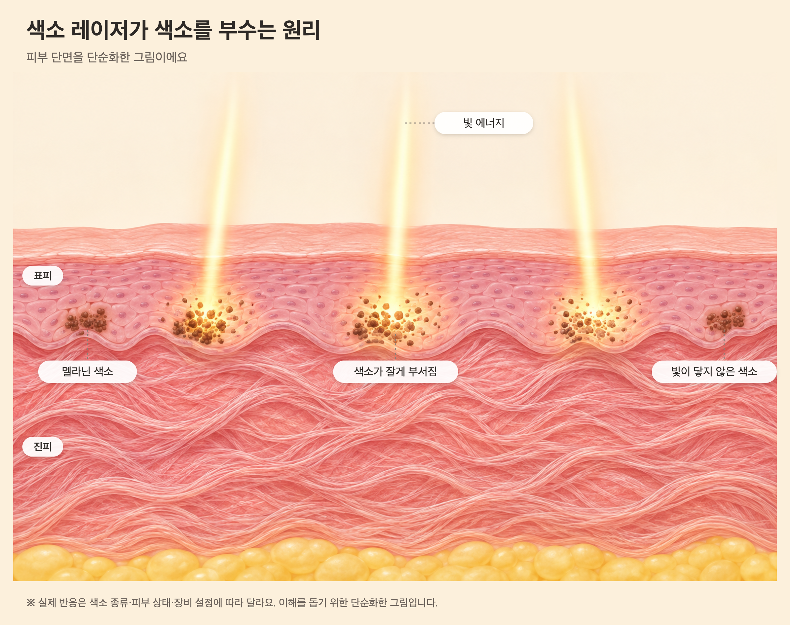

# 겨울에 색소 레이저를 시작하기 전 알아둘 점

> **작성 정보**
> 작성: 블로그 편집팀 · 의학 감수: [원장님 확인: 감수 표기 방식]
> 작성일 2026-11-26 · 최종 검토일 2026-11-26 · 다음 검토 예정일 2027-11-26
> 일반 정보 제공 목적의 글이며, AI의 도움을 받아 초안을 작성하고 사람이 검토했어요.

색소 레이저는 피부 속 멜라닌 색소에 빛 에너지를 흡수시켜 색소를 잘게 부수는 치료예요[3]. 날이 추워지면 "겨울에 시작하는 게 좋다던데" 하고 알아보시는 분이 많아서, 시작하기 전에 알아두면 좋은 점을 문헌을 바탕으로 정리했어요.

> **핵심 정리**
> - 계절에 따라 레이저 효과가 달라진다는 연구는 찾지 못했어요.
> - 시술 후 자외선 차단이 회복에 중요하고, 자외선은 겨울에도 있어요.
> - 기미와 잡티는 레이저에 대한 반응과 주의점이 달라 먼저 구분해야 해요.
> - 시술 후 붉어짐, 딱지, 일시적으로 짙어지거나 옅어지는 반응이 생길 수 있어요.

## Q1. 겨울에 시작하면 효과가 더 좋은가요?

계절에 따라 효과가 달라진다는 연구는 찾지 못했어요. 다만 레이저 뒤 자외선 차단을 일찍 시작하면 회복에 도움이 됐다는 보고가 있어서[1], 계절보다 **시술 후 차단을 꾸준히 지킬 수 있는 시기인지**가 더 중요해요. 미국피부과학회 설문에서는 성인 약 5명 중 1명이 겨울에도 햇볕에 피부가 탈 수 있다는 사실을 모르고 있었고, 흐린 날 늘 자외선 차단을 한다는 사람도 5명 중 1명 정도에 그쳤어요[4]. 겨울에 시작한다면 이 부분을 특히 챙겨야 해요.

## Q2. 내 색소가 레이저 대상인지 어떻게 알 수 있나요?

진료로 색소의 종류부터 구분하는 게 먼저예요. 색소마다 레이저에 대한 반응이 다르기 때문이에요.

- **흑자 같은 잡티**: 색소 레이저가 오래전부터 쓰여 온 치료예요[5].
- **기미**: 레이저를 받은 뒤 다시 짙어지거나, 시술 전보다 오히려 짙어지는 경우(반동 색소침착)가 있어요[5]. 그래서 바르는 약과 자외선 차단이 먼저 고려되고, 레이저는 신중하게 선택해요[5][6].
- **갈색 여드름 자국(염증 후 색소침착)**: 레이저 효과를 판단할 근거가 아직 부족해요[2].

얼룩이 기미인지 잡티인지 스스로 판단하기 어렵다면, 방법을 고르기 전에 진료로 먼저 구분해 보세요. 두 색소의 차이는 이전 글 「기미와 잡티, 어떻게 구분하나요?」에 정리해 두었어요.

## Q3. 기미라면 레이저 말고 어떤 방법이 있나요?

기미는 자외선 차단이 관리의 바탕이고, 바르는 약이 먼저 쓰여요[5][6]. 먹는 약도 연구되고 있지만 사람마다 맞는지 진료로 판단해야 해요[6]. 기미는 치료 후에도 다시 생기는 경우가 많아서[5], 한 번에 없애기보다 꾸준히 관리하는 질환으로 보는 게 좋아요. 임신, 피임약, 호르몬 치료가 기미와 관련 있을 수 있으니 해당된다면 진료 때 알려 주세요[6].

## Q4. 색소 레이저는 어떤 종류가 있나요?

빛을 쏘는 시간(펄스 길이)에 따라 크게 두 가지로 나눠요[3].

| 구분 | 나노초 레이저(Q-스위치) | 피코초 레이저 |
|---|---|---|
| 빛을 쏘는 시간 | 10억분의 1초 단위 | 1조분의 1초 단위 |
| 작용 방식 | 열과 충격을 함께 줌 | 열보다 순간적인 충격의 비중이 큼 |
| 공통점 | 둘 다 멜라닌 색소를 겨냥 | 둘 다 멜라닌 색소를 겨냥 |

두 방식을 비교한 연구가 있지만 대상이 20명으로 작아, 시술 후 색소침착 차이를 단정하기 어려워요. 같은 연구에서 시술 중 통증과 만족도는 두 방식 사이에 뚜렷한 차이가 없었어요[3]. 어떤 방식이 맞는지는 색소 종류와 피부 상태를 보고 정해요. [원장님 확인: 시행 장비 종류]

## Q5. 시술 후 어떤 반응과 부작용이 생길 수 있나요?

**치료 효과와 부작용은 피부 상태와 시술 강도에 따라 사람마다 달라요.**

- **흔한 반응**: 붉어짐, 가벼운 붓기, 작은 딱지가 생길 수 있어요. [원장님 확인: 장비별 회복 기간]
- **통증·세안·화장**: [원장님 확인: 시술 중 통증 정도·마취 크림 사용 여부, 세안·화장 가능 시점]
- **일시적으로 짙어지는 반응(시술 후 색소침착)**: 레이저 자극으로 시술 부위가 잠시 더 짙어질 수 있어요. 피부 톤이 어두운 편일수록 위험이 커서, 이런 경우 레이저 후 색소침착이 10~25% 정도로 보고되어 있어요[3]. 예전에 시술 후 색소가 짙어진 적이 있다면 꼭 미리 말씀해 주세요.
- **색이 빠지는 반응(저색소침착)**: 드물게 시술 부위가 얼룩덜룩하게 하얘질 수 있어요[5].
- **기미의 반동 색소침착과 재발**: 기미에 레이저를 하면 오히려 짙어지거나, 시간이 지나 다시 생기는 경우가 보고되어 있어요[5].
- **좋아지지 않거나 짙어지는 경우**: 갈색 여드름 자국에서는 레이저 후 좋아지지 않거나 오히려 짙어진 경우가 보고됐어요[2].

통증이 점점 심해지거나 진물·물집이 생기거나, 색소가 오래 짙어지거나 하얘지면 바로 병원에 알려 주세요.

## Q6. 시술 후 자외선 관리는 어떻게 하나요?

시술 직후부터 자외선 차단을 꾸준히 하는 게 기본이에요. 문헌에서는 시술 첫날부터 차단제를 바르기 시작하는 방식을 권하고 있어요[1].

- **자외선 차단제**: 자외선 A·B를 모두 막는 제품으로 SPF 30 이상을 권해요[1][4]. 시술 직후 예민한 피부에는 산화아연·이산화티타늄 같은 무기자차(물리적 차단) 성분이 자극이 적어 흔히 권해져요[1].
- **덧바르기**: 밖에 있을 때는 2시간마다, 땀을 흘린 뒤에는 바로 다시 발라 주세요[4].
- **겨울에도**: 흐린 날에도 자외선은 구름을 통과하고, 쌓인 눈은 자외선을 반사해 피부가 받는 양을 늘려요[4].
- **가리기**: 챙이 넓은 모자처럼 햇빛을 가리는 방법을 함께 쓰면 좋아요[4].

차단이 중요하다는 걸 알아도 꾸준히 지키기는 어렵다고 보고되어 있어요[1]. 출퇴근, 운동처럼 내 생활에서 햇빛을 오래 받는 때가 언제인지 상담 때 함께 짚어 보세요.

## Q7. 시술 전에 무엇을 준비하면 좋을까요?

최근 강한 햇빛에 많이 노출됐거나, 복용 중인 약이 있거나, 예전에 시술 후 색소침착을 겪은 적이 있다면 진료 때 꼭 말씀해 주세요. 중요한 일정이 있다면 회복 기간을 고려해 시작 시점을 함께 정해요. [원장님 확인: 시술 전 주의 대상·중단해야 할 약, 일반적인 횟수·간격]

## Q8. 상담 때 무엇을 물어보면 좋을까요?

- 제 색소는 기미, 잡티, 갈색 여드름 자국 중 무엇인가요?
- 권하시는 방법과 횟수·간격, 그 이유는 무엇인가요?
- 시술 후 붉어짐·딱지는 얼마나 가고, 화장은 언제부터 할 수 있나요?
- 제 피부 톤에서 색소가 짙어지거나 하얘질 위험은 어느 정도인가요?
- 기미라면 레이저 말고 함께 쓸 수 있는 방법은 무엇인가요?
- 전체 비용은 어떻게 되나요?

## 마무리하며

색소 레이저는 계절보다 **내 색소의 종류와 시술 후 자외선 관리**가 결과를 좌우해요. 내 색소가 어떤 종류인지 헷갈리신다면 진료로 먼저 확인해 보셔도 괜찮아요.

[추후 기입: 위치·진료 시간·예약 방법]

---

**참고 문헌**
1. [Lee KWA, Chan LKW, Song JK, et al., Importance of Using Sunscreen After Light or Laser Facial Treatment: A Literature Review (Life (Basel), 2025;15(9))](https://www.ncbi.nlm.nih.gov/pmc/articles/PMC12471997/)
2. [Agbai et al., Laser Treatments for Postinflammatory Hyperpigmentation: A Systematic Review (JAMA Dermatology, 2017)](https://pubmed.ncbi.nlm.nih.gov/27973642/)
3. [Kim JY, Yang J, Huh G, et al., A Split-Face, Single-Blinded, Randomized Controlled Comparison of 532 nm Picosecond Neodymium-Doped Yttrium Aluminum Garnet Laser versus 532 nm Q-Switched Neodymium-Doped Yttrium Aluminum Garnet Laser in the Treatment of Solar Lentigines (Ann Dermatol, 2020;32(1):8–13)](https://pmc.ncbi.nlm.nih.gov/articles/PMC7992642)
4. [American Academy of Dermatology, Survey shows sun protection lacking in winter (AAD, 2024)](https://www.aad.org/news/survey-shows-sun-protection-lacking-in-winter)
5. [Trivedi MK, Yang FC, Cho BK, A review of laser and light therapy in melasma (International Journal of Women's Dermatology, 2017;3(1):11–20)](https://pmc.ncbi.nlm.nih.gov/articles/PMC5418955)
6. [Ogbechie-Godec OA, Elbuluk N, Melasma: an Up-to-Date Comprehensive Review (Dermatology and Therapy, 2017)](https://link.springer.com/article/10.1007/s13555-017-0194-1)

※ 이 글은 색소 레이저에 대한 일반적인 정보이며, 진단이나 치료를 대신하지 않습니다. 치료 효과와 부작용은 개인에 따라 다를 수 있으므로 의료진과 충분히 상담한 뒤 결정하시기 바랍니다.
