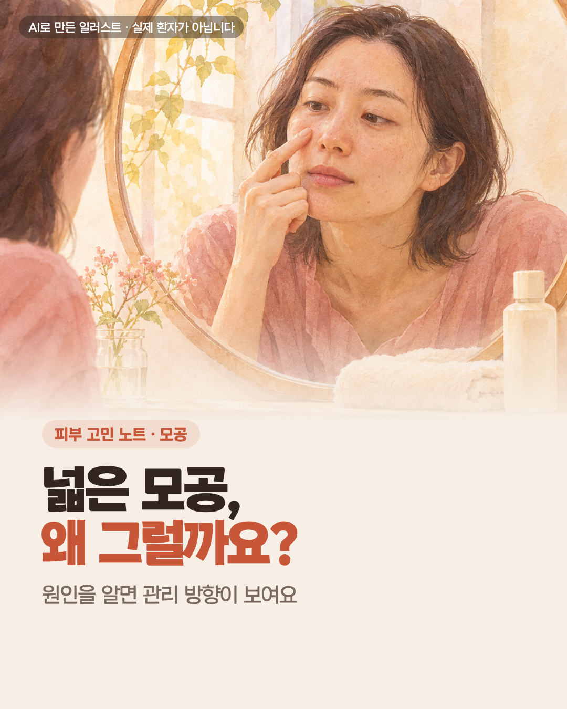
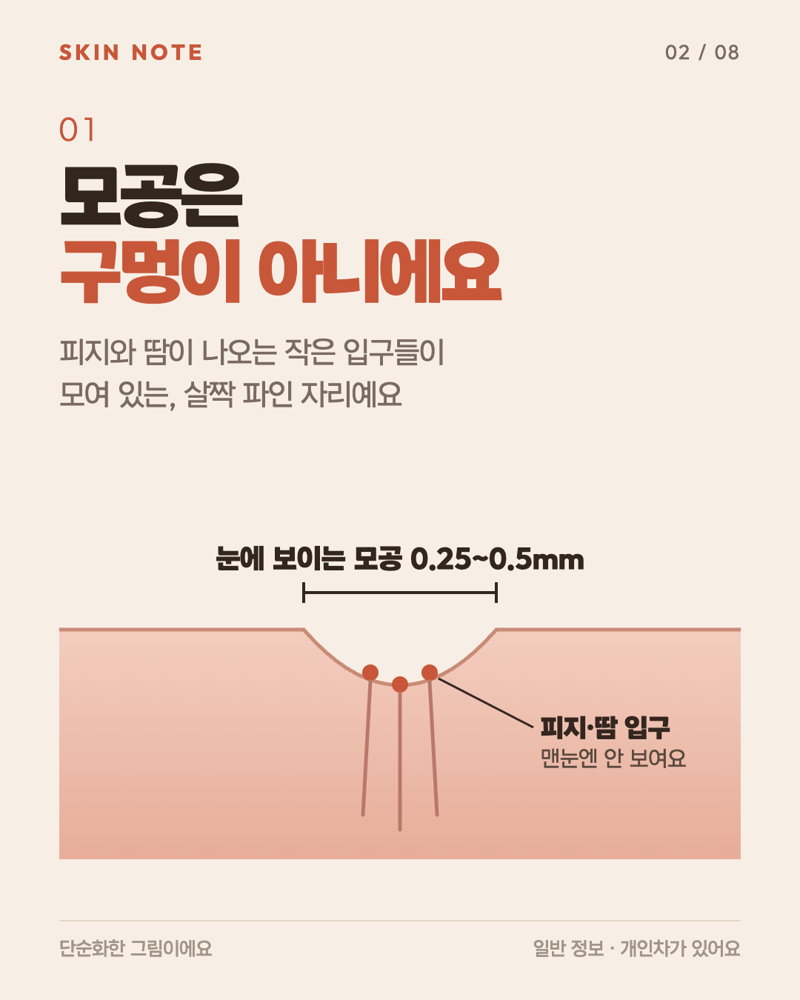
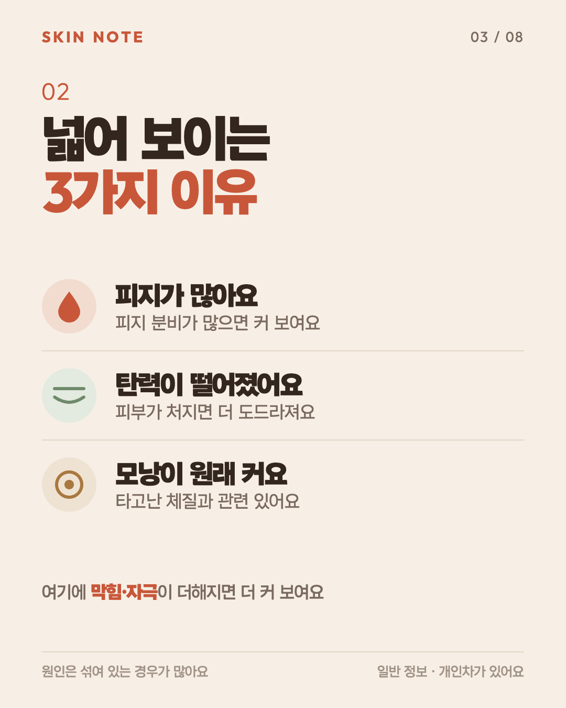
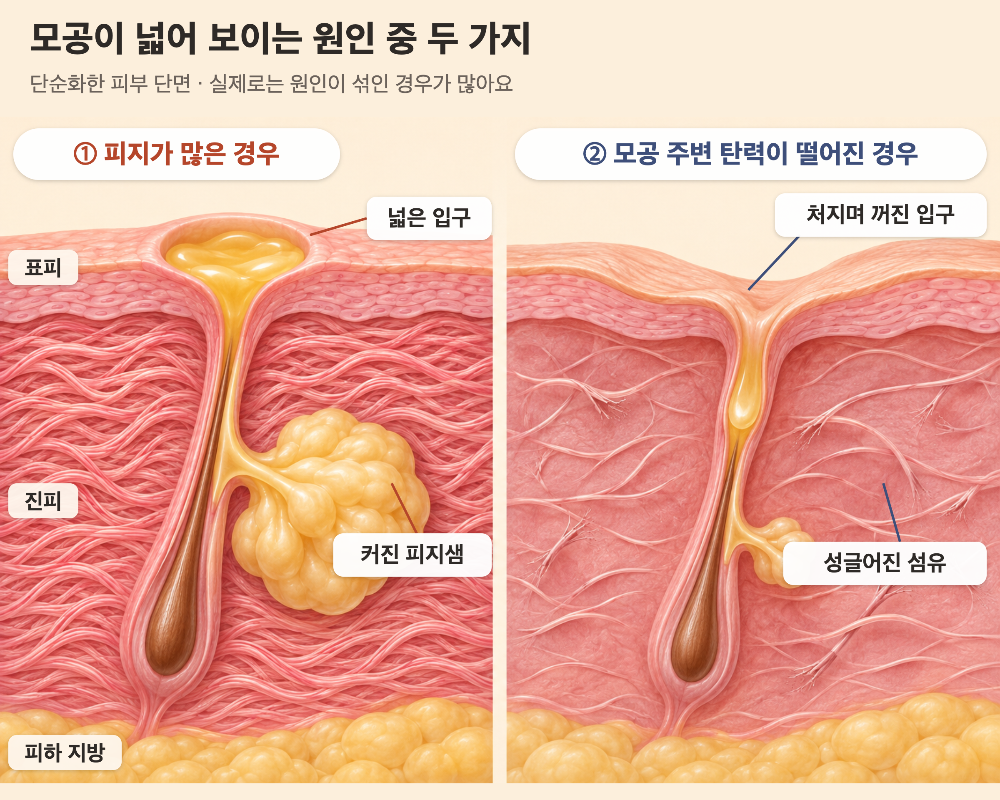
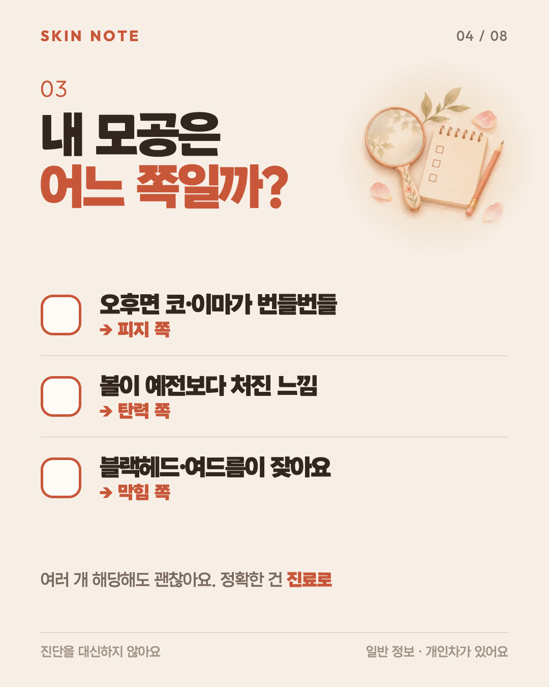
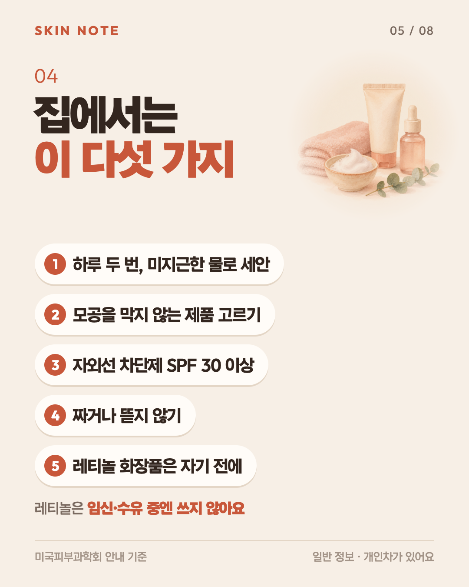
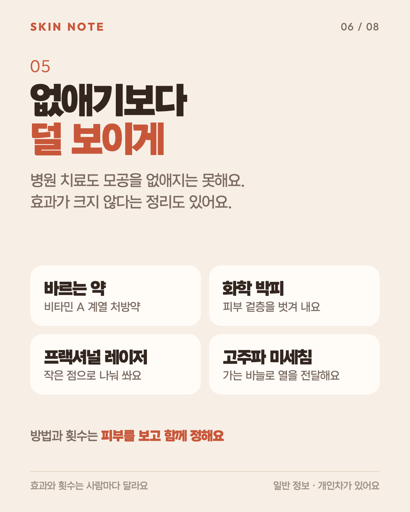
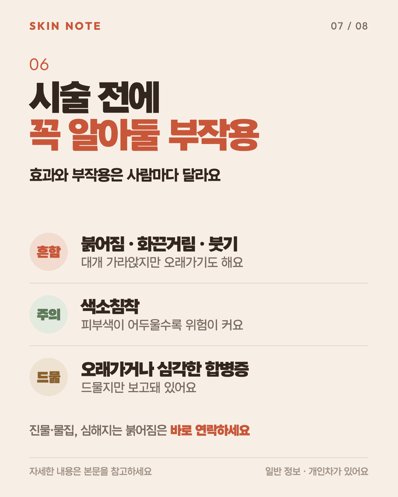
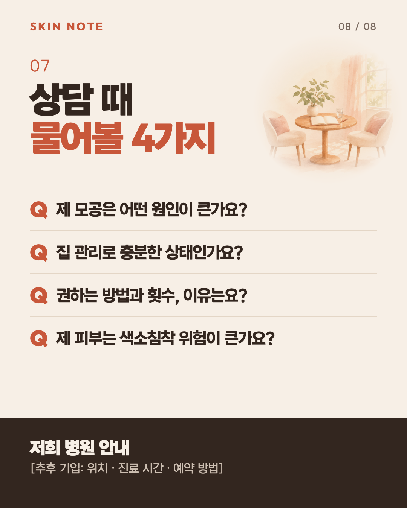

# 넓은 모공, 왜 그럴까요? 원인부터 알면 관리가 쉬워져요

> **작성 정보** · 블로그 편집팀 작성 · 의학 감수 [원장님 확인: 감수 표기 방식] · 2026-11-30
> AI의 도움을 받아 초안을 쓰고 사람이 검토한 일반 정보예요.

모공은 피지와 땀이 나오는 작은 입구들이 모여 있는, 피부 표면의 살짝 파인 자리예요.

세수하고 거울을 가까이 보면 코 옆이 유난히 신경 쓰일 때가 있죠.
"모공 줄일 수 있어요?"
상담실에서 정말 자주 듣는 질문이에요.

그런데 모공이 넓어 보이는 이유는 사람마다 달라요.
이유를 먼저 알아야 무엇을 할지도 정해지고요.
그 이야기를 카드 여덟 장에 담아 봤어요.

> **한눈에 보기**
> - 모공이 넓어 보이는 이유는 크게 피지, 탄력, 타고난 모낭 크기예요.
> - 집에서는 순하게 씻고, 막지 않고, 자외선을 막는 게 기본이에요.
> - 병원 치료도 모공을 없애지는 못해요. 부작용도 꼭 알고 시작하세요.

> **원장님 한마디**
> [원장님 확인: 모공 상담 때 자주 드리는 말 1~2문장 (효과 약속 없이)]

## 1. 모공은 정말 구멍일까요?

아니에요.
거울로 보이는 모공은 0.25~0.5mm쯤 되는 살짝 파인 자리예요.
그 안에 피지와 땀이 나오는 아주 작은 입구들이 모여 있죠.

실제 입구는 너무 작아서 맨눈에는 보이지 않아요.
병은 아니지만, 그래서 더 신경 쓰이는 고민이기도 하고요.

## 2. 모공은 왜 넓어 보일까요?

크게 세 가지예요.
피지가 많거나, 모공 주변 피부의 탄력이 떨어졌거나, 모낭이 원래 큰 경우죠.
여기에 블랙헤드처럼 모공이 막히거나 피부가 자극을 받으면 더 도드라져요.

"나이 들면 계속 커지나요?"라는 질문도 자주 받아요.
연구를 보면 40대 무렵부터는 크기가 비슷하게 유지되는 경우가 많았어요.
다만 피부가 처지면서 더 커 '보이는' 건 충분히 있을 수 있어요.

*AI로 만든 이해용 그림이며 실제 피부 사진이 아닙니다.*

## 3. 내 모공은 어느 쪽일까요?

오후만 되면 코와 이마가 번들거린다면 피지 쪽,
볼이 예전보다 처진 느낌이라면 탄력 쪽,
블랙헤드나 여드름이 잦다면 막힘 쪽에 가까워요.

대부분은 두세 가지가 섞여 있어요.
정확한 건 진료로 피부를 직접 보고 판단해요.

참, 모공처럼 보이는데 노랗게 살짝 솟은 3mm 안팎의 돌기가 있다면 '피지샘 증식증'일 수 있어요.
해롭지는 않지만 다른 피부 질환과 헷갈릴 수 있어서 한 번 확인받아 보시는 게 좋아요.

## 4. 집에서는 무엇을 하면 될까요?

미국피부과학회가 권하는 기본은 생각보다 단순해요.
하루 두 번 미지근한 물로 순하게 씻고, 모공을 막지 않는 제품을 고르고, 자외선 차단제를 바르는 것.
짜고 뜯는 습관은 오히려 모공을 도드라지게 해요.

"스팀으로 열고 찬물로 닫는다"는 얘기, 한 번쯤 들어 보셨죠?
학회 안내에는 이런 내용이 없어요.
오히려 뜨거운 물은 피부를 자극해서 모공이 커 보이게 할 수 있다고 해요.

## 5. 병원 치료로 모공을 없앨 수 있나요?

솔직히 말씀드리면, 없애지는 못해요.
바르는 약, 화학 박피, 프랙셔널 레이저, 고주파 미세침 같은 방법이 있지만 모공을 줄이는 효과는 크지 않다는 정리도 있어요.

그래서 목표를 '없애기'보다 '덜 보이게'에 두는 게 현실적이에요.
어떤 방법을 몇 번 할지는 피부를 보고 함께 정해요.
[원장님 확인: 저희 병원에서 시행하는 방법과 횟수·간격]

## 6. 시술 전에 꼭 알아둘 부작용은요?

**효과와 부작용은 피부 상태와 시술 강도에 따라 사람마다 달라요.**

붉어짐, 화끈거림, 붓기는 흔한 편이에요.
대개 가라앉지만 오래가는 경우도 있어요.
피부색이 어두울수록 색소침착(피부가 갈색으로 짙어지는 것) 위험이 커서, 아시아인 피부는 특히 조심해야 해요.
드물지만 오래가거나 심각한 합병증도 보고돼 있어요.

시술 뒤 진물이나 물집이 생기거나, 붉어짐이 점점 심해지면 바로 연락 주세요.
[원장님 확인: 시술별 회복 기간·드문 부작용·시술 주의 대상(임신·수유 등)]

## 7. 상담 때는 무엇을 물어보면 좋을까요?

카드의 네 가지 질문만 메모해 오셔도 상담이 한결 수월해져요.

[원장님 확인: 상담실 또는 진료 모습 사진 1~2장 (시술 장면·환자 얼굴 제외)]

모공은 원인을 알고 꾸준히 관리하는 게 먼저예요.
헷갈리신다면 피부 상태부터 확인해 보셔도 괜찮아요.
저희 병원에서 차근차근 설명드릴게요.

[추후 기입: 위치·진료 시간·예약 방법·시술 후 이상 시 연락 방법]

---

**참고 문헌**
1. [Chan L, Enlarged pores (DermNet, 2017)](https://dermnetnz.org/topics/enlarged-pores)
2. [Flament F, et al., Facial skin pores: a multiethnic study (Clin Cosmet Investig Dermatol, 2015)](https://pmc.ncbi.nlm.nih.gov/articles/PMC4337418/)
3. [Lee SJ, et al., Facial pores: definition, causes, and treatment options (Dermatol Surg, 2016)](https://pubmed.ncbi.nlm.nih.gov/26918966/)
4. [American Academy of Dermatology, What can treat large facial pores? (AAD, 열람 2026)](https://www.aad.org/public/everyday-care/skin-care-secrets/face/treat-large-pores)
5. [Oakley A, Ngan V, Sebaceous hyperplasia (DermNet, 2014)](https://dermnetnz.org/topics/sebaceous-hyperplasia)
6. [American Academy of Dermatology, Chemical peels: FAQs (AAD, 열람 2026)](https://www.aad.org/public/cosmetic/younger-looking/chemical-peels-faqs)
7. [Wat H, et al., Fractional resurfacing in the Asian patient (Lasers Surg Med, 2017)](https://pubmed.ncbi.nlm.nih.gov/27605303/)
8. [Metelitsa AI, Alster TS, Fractionated laser skin resurfacing treatment complications: a review (Dermatol Surg, 2010)](https://pubmed.ncbi.nlm.nih.gov/20100273/)

※ 이 글은 모공에 대한 일반적인 정보이며, 진단이나 치료를 대신하지 않습니다. 치료 효과와 부작용은 개인에 따라 다를 수 있으므로 의료진과 충분히 상담한 뒤 결정하시기 바랍니다.
